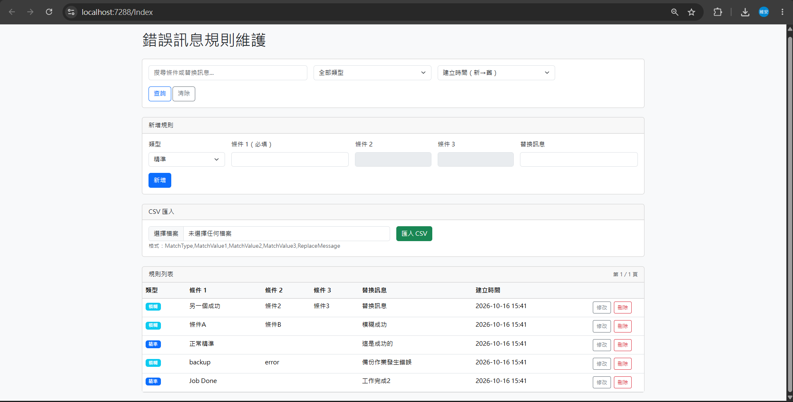
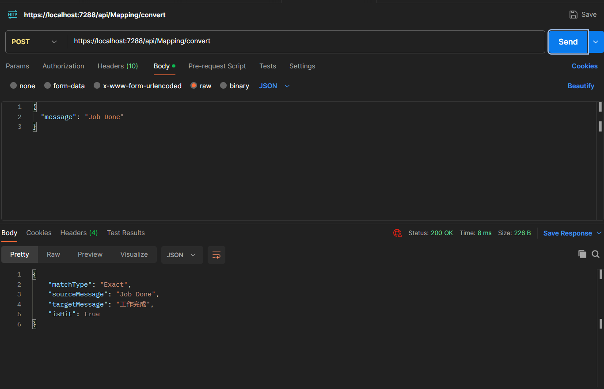

# Error Message Mapping Service


一個用於將系統錯誤訊息轉換為較易理解文字的服務。支援精準比對與模糊比對，並提供維護頁面與轉換 API。

本專案以 .NET 8 實作，採用分層架構，重點展示核心比對邏輯、可測試性與基本維運考量。

## 畫面預覽

### 維護頁面



### 轉換 API



## 功能特色

- **精準比對**：完全相等（忽略大小寫與前後空白）
- **模糊比對**：多條件 AND 包含比對，條件數多的優先
- **比對優先順序**：先精準，再模糊
- **維護頁面**
  - 新增 / 修改 / 刪除規則
  - 關鍵字搜尋
  - 類型篩選（精準 / 模糊）
  - 排序（建立時間、類型）
  - 分頁（每頁 10 筆）
  - CSV 匯入（含成功 / 跳過統計與明細）
- **轉換 API**：需帶 API Key
- **Logging**：使用 Serilog 寫入每日滾動檔案
- **單元測試**：核心比對邏輯（In-Memory Repository）

## 技術棧

- .NET 8
- ASP.NET Core（Web API + Razor Pages）
- Entity Framework Core + SQLite
- Bootstrap 5
- Serilog
- xUnit

## 專案結構

```
ErrorMessageMapping/
├── src/
│   ├── Domain/                  # 實體、常數
│   ├── Application/             # 比對邏輯、Repository 介面
│   ├── Infrastructure/          # EF Core、SQLite 實作
│   └── Web/                     # API + 維護頁面
├── tests/
│   └── Application.Tests/       # 單元測試
└── README.md
```

## 比對規則說明

1. 先進行精準比對（`MatchType = Exact`）
2. 未命中再進行模糊比對（`MatchType = Fuzzy`）
3. 模糊比對時：
   - 所有有填寫的條件都必須出現在原文中（AND）
   - 條件數較多的規則優先
   - 條件數相同時，較早建立的優先
4. 比對時忽略大小寫與前後空白
5. 未命中時回傳原始訊息

## 如何執行

### 環境需求

- .NET 8 SDK
- Visual Studio 2022 或以上（或 VS Code + C# Dev Kit）

### 步驟

1. Clone 專案
2. 還原套件（Visual Studio 通常會自動還原）
3. 將 `ErrorMessageMapping.Web` 設為啟動專案
4. 按 F5 執行

啟動後會自動建立 SQLite 資料庫（`errormapping.db`）並寫入種子資料。

- 維護頁面：`https://localhost:{port}/`
- Swagger：`https://localhost:{port}/swagger`（若有保留）
- 轉換 API：`POST /api/Mapping/convert`

### API Key

開發環境建議使用 User Secrets：

```bash
dotnet user-secrets set "ApiKey" "your-key-here"
```

呼叫轉換 API 時需在 Header 帶上：

```
X-Api-Key: your-demo-api-key-12345
```

### CSV 匯入格式

```csv
MatchType,MatchValue1,MatchValue2,MatchValue3,ReplaceMessage
Exact,Work Complete,,,此筆已處理完成
Fuzzy,limit price,reference price,,委託價距離市場價格太遠
```

- `MatchType` 僅接受 `Exact` 或 `Fuzzy`
- 精準規則只使用條件 1
- 類型或條件 1 為空白的列會被跳過

## 單元測試

```bash
dotnet test
```

或於 Visual Studio 的測試總管執行。

測試涵蓋：

- 精準 / 模糊命中
- 精準優先於模糊
- 模糊條件數優先
- 空值、大小寫、Trim 等邊界情況

## Logging

使用 Serilog 將 log 寫入 `logs/app-yyyyMMdd.log`。

主要記錄：

- 轉換 API 的命中 / 未命中
- 維護操作（新增、修改、刪除、匯入）
- 未處理例外與匯入異常

## 設計取捨

- **每次請求載入規則**：規則量少時單純可靠；若未來規則增多可改為快取。
- **未處理並發更新**：後寫入者覆蓋先寫入者。若需嚴格控制可加入樂觀鎖定（使用RowVersion）。
- **SQLite**：方便本機執行與展示，可輕易替換為 SQL Server 或其他資料庫（主要修改 Infrastructure 與連線設定）。

## 未來可改進方向

- 規則快取（減少資料庫查詢）
- 樂觀鎖定
- 更完整的輸入驗證與長度限制
- Docker 支援
- CI（GitHub Actions）

## 授權

本專案為個人學習與作品集用途。
